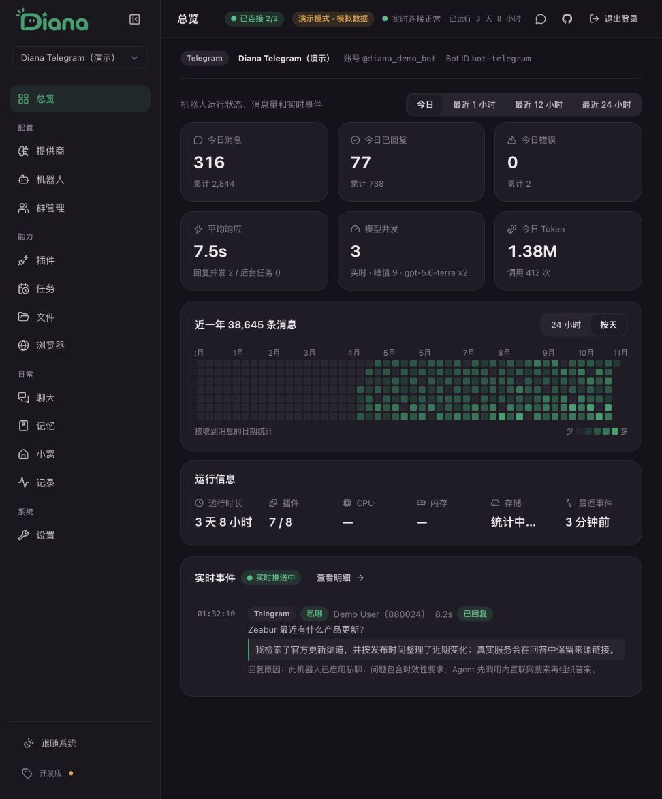

<div align="center">

# Diana

[简体中文](./README.md) · [English](./README.en.md) · [日本語](./README.ja.md) · [한국어](./README.ko.md) · **Français** · [Deutsch](./README.de.md) · [Nederlands](./README.nl.md)

**Parle comme un humain, travaille comme un agent.**

Un agent IA auto-hébergé en un seul binaire — il sait quand intervenir dans vos discussions de groupe et quand se taire sans être mentionné ; il gère la mémoire, la vision, les liens, la musique, la recherche web, Skills / MCP et les agents de code locaux, tout en gardant vos données et chaque décision sur votre machine.

<sub>OneBot v11 · Telegram · QQ Official Bot · WeChat · iMessage · Console intégrée — une seule instance, tous en ligne simultanément</sub>

[](https://github.com/SuInk/Diana/actions/workflows/ci.yml)
[](https://github.com/SuInk/Diana/releases/latest)
[](https://go.dev/)
[](./LICENSE)

[Site officiel](https://suink.github.io/Diana/fr/) · [Documentation (EN)](https://suink.github.io/Diana/en/deploy.html) · [Démo en ligne](https://suink.github.io/Diana/demo/) · [Dernière version](https://github.com/SuInk/Diana/releases/latest)

[](https://qm.qq.com/q/4o6zEBs4h2)

</div>

<br />



## Pourquoi Diana

La plupart des bots de chat auto-hébergés tombent dans deux extrêmes : soit un gadget muet tant qu'on ne le mentionne pas (ou qui spamme dès qu'on active les réponses proactives), soit un empilement d'environnements Python/Node et de fichiers YAML qui cesse de répondre sans aucune explication.

Diana réunit une vraie présence conversationnelle et de solides capacités d'agent dans un unique binaire Go — connecté d'un côté aux principaux LLM (API compatibles OpenAI, Gemini, Anthropic), de l'autre à vos messageries quotidiennes, avec une console web intégrée pour tout piloter.

- **Sait quand parler — et quand se taire** — intervient naturellement dans les groupes sans `@`, retient les habitudes et accords grâce à une mémoire par couches et un carnet modifiable, et gère images, liens vidéo, musique et stickers.
- **Accomplit de vraies tâches depuis le chat** — recherche web, analyse de documents et rendu de diagrammes intégrés ; boucle d'agent avec Skills, MCP, navigateur et délégation vers Claude Code / Codex en local.
- **Opérationnel en 3 minutes, zéro boîte noire** — installation en une commande, connexions sortantes sans IP publique, configuration depuis le navigateur et centre d'événements expliquant pourquoi chaque message a reçu (ou non) une réponse et combien de tokens il a coûté.
- **Vos données, des limites de sécurité claires** — configuration, mémoire et journaux restent dans un SQLite local sans cloud ; le **Mode sécurisé** isole en un clic les commandes système, l'écriture de fichiers et les agents de code contre l'injection de prompts.

## Démarrer en trois minutes

**① Installer.** Copiez une commande ; le script télécharge, vérifie le SHA-256 et démarre Diana :

```sh
# Linux / macOS
curl -fsSL https://raw.githubusercontent.com/SuInk/Diana/main/scripts/install.sh | sh
```

```sh
# Android Termux (ARM64 uniquement ; à lancer dans Termux, sans root)
pkg install -y curl tar coreutils && curl -fsSL https://raw.githubusercontent.com/SuInk/Diana/main/scripts/install.sh | sh
```

```powershell
# Windows PowerShell
irm https://raw.githubusercontent.com/SuInk/Diana/main/scripts/install.ps1 | iex
```

```sh
# Ou avec Docker (à lancer dans le dossier destiné aux données)
curl -fsSL https://raw.githubusercontent.com/SuInk/Diana/main/scripts/docker.sh | sh
```

L'installeur natif ne requiert aucun droit administrateur. **Pour mettre à jour, relancez la même commande.** Plus d'options dans le [guide de déploiement](https://suink.github.io/Diana/en/deploy.html).

**Ou laissez un assistant IA l'installer via le Skill.** Collez cette instruction dans un assistant capable d'exécuter des commandes (instructions synchronisées avec chaque version dans le [Skill d'installation](skills/diana-install/SKILL.md)) :

```text
Read https://raw.githubusercontent.com/SuInk/Diana/main/skills/diana-install/SKILL.md and follow it to install the latest stable release of Diana on this machine.
```

**Ou téléchargement manuel** (toujours la dernière version stable) :

| Plateforme | Téléchargement | Lancement |
| --- | --- | --- |
| Windows x64 | [diana-windows-amd64.exe](https://github.com/SuInk/Diana/releases/latest/download/diana-windows-amd64.exe) | Placez-le dans un dossier dédié et double-cliquez (données dans `data`) |
| macOS Apple Silicon | [diana-macos-arm64.tar.gz](https://github.com/SuInk/Diana/releases/latest/download/diana-macos-arm64.tar.gz) | Décompressez puis lancez `./run.sh` |
| macOS Intel | [diana-macos-amd64.tar.gz](https://github.com/SuInk/Diana/releases/latest/download/diana-macos-amd64.tar.gz) | Décompressez puis lancez `./run.sh` |
| Linux x64 | [diana-linux-amd64.tar.gz](https://github.com/SuInk/Diana/releases/latest/download/diana-linux-amd64.tar.gz) | Décompressez puis lancez `./run.sh` |
| Linux ARM64 | [diana-linux-arm64.tar.gz](https://github.com/SuInk/Diana/releases/latest/download/diana-linux-arm64.tar.gz) | Décompressez puis lancez `./run.sh` |
| Android (Termux) | [diana-android-arm64.tar.gz](https://github.com/SuInk/Diana/releases/latest/download/diana-android-arm64.tar.gz) | Décompressez dans Termux puis lancez `./run.sh` (serveur, pas une app Android) |

L'interface web est compilée dans le binaire : Node.js n'est pas nécessaire. Les empreintes SHA-256 figurent dans [`latest.json`](https://github.com/SuInk/Diana/releases/latest/download/latest.json) et sur [Releases](https://github.com/SuInk/Diana/releases).

**② Se connecter à la console.** Ouvrez `http://127.0.0.1:18080`. L'identifiant et le mot de passe administrateur initiaux s'affichent une seule fois dans le terminal (ou via `docker logs diana`) : conservez-les immédiatement. En cas d'oubli, réinitialisez-les avec `diana passwd`.

**③ Configurer.** Trois étapes dans la console :

1. Dans **LLM**, ajoutez votre clé API, synchronisez la liste des modèles et choisissez un modèle par défaut.
2. Dans **Bots**, sélectionnez une plateforme et saisissez ses identifiants (ou utilisez directement le **Bot intégré** pour tester sans rien configurer).
3. Envoyez un message : en privé, il répond directement ; en groupe, mentionnez-le ou utilisez un mot déclencheur.

> [!TIP]
> **Accéder à la console depuis un autre appareil :** par défaut, Diana n'écoute que sur `127.0.0.1`. Relancez l'installeur avec `-s -- --host 0.0.0.0` (Windows : `-BindHost 0.0.0.0`) et placez toujours un proxy inverse HTTPS devant toute exposition publique.

## Plateformes prises en charge

Tous les profils activés fonctionnent en parallèle et chaque réponse revient sur son canal d'origine. Les réseaux domestiques et locaux fonctionnent sans IP publique.

| Plateforme | Identifiants requis | Sens de connexion |
| --- | --- | --- |
| **OneBot v11** (SnowLuma recommandé) | WebSocket inversé, WebSocket direct ou HTTP API + événements | Selon le mode ; compatible LAN |
| **Telegram** | Bot Token fourni par BotFather | Connexion sortante depuis Diana (aucune IP publique) |
| **QQ Official Bot** | AppID + AppSecret de la plateforme ouverte QQ | Connexion sortante depuis Diana (aucune IP publique) |
| **WeChat** | Aucun champ : enregistrez le bot puis scannez le QR code (Tencent iLink Bot, privé uniquement) | Connexion sortante depuis Diana (aucune IP publique) |
| **iMessage** | Adresse et mot de passe de BlueBubbles Server sur un Mac ([guide](docs/imessage.md)) | Webhook BlueBubbles → Diana (polling en secours) |
| **Bot intégré** | Aucun : discutez ou passez un appel vocal directement dans l'onglet Chat de la console | Console uniquement ; essai immédiat |

## Capacités intégrées

Toutes ces fonctions sont incluses dans le binaire et configurables depuis la console, sans plugin à installer :

- **Participation proactive** — décide seul quand intervenir et quand rester silencieux dans un groupe, avec chaque décision tracée dans le centre d'événements.
- **Mémoire et carnet** — mémoire hiérarchique pour maîtriser les coûts en tokens, complétée par un carnet auditable, modifiable et restaurable pour les faits importants.
- **Agent intégré et Mode sécurisé** — boucle d'outils (fichiers, commandes, navigateur) avec chargement à la demande de Skills et serveurs MCP ; activez le **Mode sécurisé** par bot pour bloquer les outils sensibles face aux injections de prompts.
- **Agent de code** — réservé au propriétaire, désactivé par défaut : confiez des modifications longues et tests à Claude Code / Codex CLI en local sur vos dépôts enregistrés, avec reprise après redémarrage et confirmation dans le chat avant toute action risquée.
- **Recherche web** — recherche parallèle via navigateur isolé par défaut, avec fournisseurs globaux configurables (Exa, Tavily ou personnalisé).
- **Analyse de liens et fichiers** — extrait médias et profils depuis Bilibili / YouTube / X / Xiaohongshu / Douyin ainsi que les fichiers PDF, Office et EPUB.
- **Vision, OCR et rendu d'images** — modèles de vision + OCR hors ligne pour que même un modèle texte lise les captures ; tableaux et diagrammes Markdown / Mermaid / SVG rendus automatiquement en image.
- **Musique, stickers et politiques par groupe** — demandes musicales multi-sources, sélection contextuelle de stickers et réglages fins par groupe (horaires, persona, listes blanches/noires, permissions d'outils).

Référence complète dans la [documentation de configuration](https://suink.github.io/Diana/en/configuration.html).

## Gestion quotidienne

Une fois installé, la commande `diana` est disponible dans le PATH :

```sh
diana status    # état, version, adresse
diana logs -f   # suivre les journaux
diana restart   # redémarrer le service
diana doctor    # diagnostic de configuration et santé
```

Avec Docker, exécutez `docker exec diana diana <commande>` depuis l'hôte.

- **Mot de passe oublié** : `diana passwd` (installation native) ou `docker compose stop diana && docker compose run --rm diana passwd && docker compose start diana` (Docker).
- **Mise à jour** : relancez la commande d'installation ou mettez à jour depuis la console ; sauvegarde automatique des données et retour arrière en cas d'échec du contrôle de santé.
- **Désinstallation** : `diana uninstall` retire le service en conservant les données ; `diana uninstall --purge` supprime aussi toutes les données de façon définitive.

## Sécurité

- Connexion obligatoire dès le premier démarrage, avec verrouillage progressif par IP contre la force brute.
- Les clés API et jetons enregistrés ne sont jamais renvoyés en clair.
- Derrière un proxy inverse, renseignez impérativement `trusted_proxies` dans `config.yaml` (ou la variable `DIANA_TRUSTED_PROXIES`).
- Avec un compte propriétaire configuré, la connexion rapide par code à 6 chiffres envoyé en message privé au bot renvoie immédiatement l'IP et l'appareil demandeur.

## Contribuer

Backend en Go (Gin + SQLite), frontend en Vue 3 + TypeScript (`frontend/`).

```sh
make dev        # backend :18080 + Vite :5173
go test ./...   # tests backend
```

Les PR sont les bienvenues ! Consultez [CONTRIBUTING.md](./CONTRIBUTING.md) et [AGENTS.md](./AGENTS.md).

## Documentation

| | |
| --- | --- |
| [Déploiement](https://suink.github.io/Diana/en/deploy.html) | Méthodes d'installation, serveur, première connexion |
| [Configuration](https://suink.github.io/Diana/en/configuration.html) | Canaux, routage de modèles, politiques de groupe, sécurité |
| [Architecture](https://suink.github.io/Diana/en/implementation.html) | Conception interne, pipeline de décision, couches de mémoire |
| [Pipeline](https://suink.github.io/Diana/en/pipeline.html) | Diagrammes des déclencheurs, exécution d'agent, navigateur et revue |
| [Exploitation](https://suink.github.io/Diana/en/operations.html) | Mises à jour, sauvegardes, dépannage |
| [Démo en ligne](https://suink.github.io/Diana/demo/) | La vraie console avec des données simulées |

## Licence

`Limited Redistribution License (SuInk)` — voir [LICENSE](./LICENSE).
