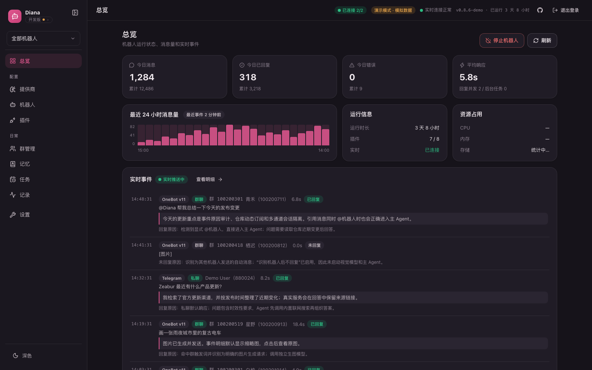

<div align="center">

# Diana

**住在群聊里、会主动搭话的 AI Agent —— 不用 @ 也能自然插话，还会搜索、点歌、发表情包、记住群里的约定；自托管单二进制，数据不出你的机器。**

<sub>OneBot v11 · Telegram · QQ 官方机器人 · 微信 · iMessage —— 一个实例，同时在线</sub>

[](https://github.com/SuInk/Diana/actions/workflows/ci.yml)
[](https://github.com/SuInk/Diana/releases/latest)
[](https://go.dev/)
[](./LICENSE)

[官网与文档](https://suink.github.io/Diana/) · [在线演示](https://suink.github.io/Diana/demo/) · [下载最新版本](https://github.com/SuInk/Diana/releases/latest) · [English](./README.en.md)

[](https://qm.qq.com/q/4o6zEBs4h2)

</div>

<br />



## Diana 是什么

你有一个想接进群聊的 AI：让它在 QQ 群里搭话、在 Telegram 里点歌、替你回答群友的问题。Diana 就是中间这一层——一个 Go 写成的单二进制服务，一头对接大模型（OpenAI 兼容接口、Gemini、Anthropic 都行），另一头同时对接五种聊天平台，中间有一个网页控制台管理一切。

它为「自己养一个机器人」的人设计：

- **装完就能用** —— 一条命令安装，浏览器里点几下完成配置，不需要写代码。
- **数据在你手里** —— 配置、聊天记忆、日志全部存在本机 SQLite，没有云端依赖。
- **每一步都能解释** —— 机器人为什么回、为什么没回、调了哪个模型、花了多少 token，控制台事件中心里都查得到。
- **能力开箱即备** —— 联网搜索、链接/文件解析、点歌、表情包、OCR、长期记忆都是内置的，开关在控制台里。

## 三分钟跑起来

**① 安装。** 复制一条命令运行，脚本会自动下载、校验并启动：

```sh
# Linux / macOS
curl -fsSL https://raw.githubusercontent.com/SuInk/Diana/main/scripts/install.sh | sh
```

```powershell
# Windows PowerShell
irm https://raw.githubusercontent.com/SuInk/Diana/main/scripts/install.ps1 | iex
```

```sh
# 或者用 Docker（在想放数据的目录里运行）
curl -fsSL https://raw.githubusercontent.com/SuInk/Diana/main/scripts/docker.sh | sh
```

原生安装不需要管理员权限。**升级也是重跑同一条命令**；以前用 sudo 装过的，脚本会自动接着用原来的安装。更多安装方式见[部署文档](https://suink.github.io/Diana/deploy.html)。

**或者用 Prompt 安装。** 把下面这段话复制给能在目标机器执行命令的 AI 助手：

```text
请帮我在当前机器安装 Diana 最新稳定版。先阅读 https://github.com/SuInk/Diana 的 README 和仓库里的 scripts/install.sh（Linux/macOS）或 scripts/install.ps1（Windows），识别系统与架构，使用官方一键安装脚本安装。默认使用当前用户权限、仅监听 127.0.0.1；如果已有安装，保留现有配置和数据并按官方流程升级。完成后运行 diana doctor 检查健康状态，告诉我控制台地址、管理员账号和安装时首次生成的密码，并提醒我妥善保存；如果是已有安装且没有生成新密码，说明继续使用原密码，不要自动重置。需要我提供的模型 API Key 和机器人凭据，等我在控制台填写。
```

**或者手动下载。** 不想跑脚本就直接下载对应平台的文件（总是最新稳定版）：

| 平台 | 下载 | 用法 |
| --- | --- | --- |
| Windows x64 | [diana-windows-amd64.exe](https://github.com/SuInk/Diana/releases/latest/download/diana-windows-amd64.exe) | 放进单独的文件夹后双击运行，数据存在旁边的 `data` 目录 |
| macOS Apple 芯片 | [diana-macos-arm64.tar.gz](https://github.com/SuInk/Diana/releases/latest/download/diana-macos-arm64.tar.gz) | 解压后运行 `./run.sh` |
| macOS Intel | [diana-macos-amd64.tar.gz](https://github.com/SuInk/Diana/releases/latest/download/diana-macos-amd64.tar.gz) | 解压后运行 `./run.sh` |
| Linux x64 | [diana-linux-amd64.tar.gz](https://github.com/SuInk/Diana/releases/latest/download/diana-linux-amd64.tar.gz) | 解压后运行 `./run.sh` |
| Linux ARM64 | [diana-linux-arm64.tar.gz](https://github.com/SuInk/Diana/releases/latest/download/diana-linux-arm64.tar.gz) | 解压后运行 `./run.sh` |
| 安卓（Termux） | [diana-android-arm64.tar.gz](https://github.com/SuInk/Diana/releases/latest/download/diana-android-arm64.tar.gz) | 在 Termux 里解压后运行 `./run.sh`；它是跑在手机上的服务端，不是安卓 App。Termux 里也能直接用上面的 Linux 一键命令 |

WebUI 已编进程序，不需要装 Node.js。校验用同一 Release 的 [`SHA256SUMS.txt`](https://github.com/SuInk/Diana/releases/latest/download/SHA256SUMS.txt)，历史版本见 [Releases](https://github.com/SuInk/Diana/releases)。手动下载的不会注册 `diana` 命令，管理命令用 `./diana-webui <命令>`（Windows：`diana-webui.exe <命令>`）。

**② 登录控制台。** 浏览器打开 `http://127.0.0.1:18080`（从别的设备访问就换成这台机器的 IP）。管理员账号密码在安装结束时显示在终端里，**只显示一次，请当场保存**；Docker 可用 `docker logs diana` 查看。忘了密码运行 `diana passwd` 重置。

**③ 配置。** 控制台里依次完成三件事：

1. 「LLM 配置」页填上你的 API Key，同步模型列表，选一个默认模型；
2. 「机器人」页选平台、填凭据（各平台要填什么见[支持的平台](#支持的平台)）；
3. 给机器人发条消息试试——私聊直接回，群聊要 @ 它或用触发词开头。

就这些。没回复？事件中心会告诉你原因；`diana doctor` 能检查服务健康。

> [!TIP]
> **从别的电脑打不开控制台？** 默认只允许本机访问。安装命令后面加 `-s -- --host 0.0.0.0`（Windows：`-BindHost 0.0.0.0`）重跑一遍即可，详见[部署文档](https://suink.github.io/Diana/deploy.html)。开放后请套 HTTPS 反向代理，别把控制台直接暴露在公网。


## 支持的平台

Telegram 主人账号支持数字 ID、用户名和 `@用户名`，按平台真实发送者信息核验，参见[Telegram 主人账号](docs/telegram-owner.md)。

Telegram 的图片/表情包发送格式及群消息撤回边界，参见[Telegram 媒体与撤回说明](docs/telegram-media.md)。普通群消息删除不会通过 Bot API 实时通知机器人；用户查询撤回记录时，Diana 会按需检查本群最近 24 小时缓存中的有限消息，默认把明确确认已不可访问的完整缓存原文与媒体发回当前会话。

启用的机器人配置会同时在线，回复始终回到消息来的那个通道。

| 平台 | 要准备的凭据 | 连接方向 |
| --- | --- | --- |
| **OneBot v11**（推荐 SnowLuma） | 支持正向 WS、反向 WS、HTTP API + HTTP 事件上报，在机器人页选择连接方式 | 连接方向取决于所选方式，可在局域网使用 |
| **Telegram** | BotFather 的 Bot Token（国内网络通常还要代理地址） | Diana 主动出站，无需公网 |
| **QQ 官方机器人** | 开放平台的 AppID + AppSecret（未上架可用沙箱） | Diana 主动出站，无需公网 |
| **微信** | 不用填：保存机器人后在「接入」里扫码登录（腾讯 iLink Bot，只有私聊） | Diana 主动出站，无需公网 |
| **iMessage** | 常开 Mac 上 BlueBubbles Server 的地址与密码，详见 [iMessage 接入说明](docs/imessage.md) | BlueBubbles webhook → Diana，Mac 能访问到 Diana 即可，可选轮询兜底 |

QQ 个人号推荐用 SnowLuma 作 OneBot 接入端，Diana 的群历史、成员信息等接口按它的行为做过适配。

OneBot v11 连接方式：

- **反向 WS（默认）**：接入端连接 `ws://<Diana 主机>:18080/onebot/v11/ws`，双方填写相同的 Access Token；旧配置无需修改。
- **正向 WS**：在机器人页填写接入端的通用 WS 地址，例如 `ws://127.0.0.1:6700/`（同时提供 API 和事件，不能只填 `/api` 或 `/event`），Diana 主动连接并在断线后重试。
- **HTTP**：填写接入端 HTTP API 地址，例如 `http://127.0.0.1:5700`；接入端把事件 POST 到 `http://<Diana 主机>:18080/onebot/v11/http`。双方设置相同的 HTTP 事件签名密钥（接入端的 `secret`，HMAC-SHA1），API 的 Access Token 单独配置。Diana 异步处理事件并通过 HTTP API 回复，不使用上报响应中的快速操作。HTTP 状态表示 API 探测结果，仍需确认接入端已配置事件上报。

固定的反向 WS 入口和 HTTP 上报入口各支持一个启用中的配置档（同类取第一个）；正向 WS 可配置多个机器人。Docker 中 `127.0.0.1` 指容器自身，服务地址须按实际网络调整。这里支持的是 OneBot v11 的三种连接方式，不包含 OneBot v12 的不同事件/API 格式。

iMessage 要填到 BlueBubbles Server 的回调地址，机器人页会直接显示出来。各平台功能上的细微差异（比如 QQ 官方机器人默认只收得到 @ 消息，需要群主修改机器人可获取的群聊消息范围）见[配置文档](https://suink.github.io/Diana/configuration.html)。

## 内置能力

这些能力随程序自带，在控制台里按需开关和配置，不需要安装插件：

- **主动搭话** —— 不用 @ 也能自己判断什么时候插话、什么时候保持安静，回不回、为什么，事件中心都有记录（依赖平台推送全量群消息：QQ 官方机器人要群主在群聊设置里改成获取群内全部消息）。
- **联网搜索** —— 时效性问题先检索再回答，默认用沙盒浏览器搜索；多个查询可并行执行，模型选择相关官网页面继续读取。 在「提供商 → 搜索提供商」全局统一设置开关、主备来源、地址与密钥，机器人不再单独覆盖；历史机器人搜索配置不会自动迁移密钥，升级后请检查全局设置。详见 [搜索提供商配置](docs/search-providers.md)。
- **链接解析** —— B 站 / YouTube / X / 小红书 / 抖音的视频图片直接解析发到群里；X / Twitter 用户主页展示昵称、简介及可见统计，不再误走视频下载。详情见 [Twitter 主页解析](docs/twitter-profiles.md)。
- **文件解析** —— 群文件、PDF、Office、EPUB 的内容提取后交给模型理解。
- **点歌** —— 网易云、QQ 音乐多曲库自动切换。OneBot QQ 发语音；Telegram 将歌曲转为带歌名和歌手信息的 MP3 后直接上传，显示原生音乐播放器，无需 QQ 音乐卡片签名服务。音频不可用或准备失败时明确提示失败。QQ 官方机器人目前只提供歌曲来源页链接，并非聊天内播放器。
- **表情包** —— 从群里见过的表情包中挑一张合适的发出去。
- **图片识别** —— 视觉模型 + OCR（支持完全离线的本地方案），纯文本模型也能「看」图。 支持关闭图片自动描述、视频自动下载抽帧；默认只把图片描述交给对话模型，要看细节时带着问题问视觉模型，见[媒体预处理](docs/media-preprocessing.md)。
- **画图出图** —— 表格、流程图、时序图这类纯文本讲不清的东西，模型自己判断该出图时渲染成图片发出来（Markdown / Mermaid / SVG，需要「网页渲染」插件提供的无头浏览器）。 缺失字体会按实际文字自动下载，支持[多语言出图](docs/fonts.md)。
- **记忆与笔记本** —— 分层记忆控制 token 消耗；重要的事（群规、忌口、约定）记进笔记本，可审可改可恢复。
- **随机复读** —— 在机器人「行为 → 随机复读」中开启后，不同群友连续发送相同纯文字时随机跟读。默认两人、30% 概率、60 秒冷却，可按群调整；达到人数后每条新复读都按概率判断，成功后进入冷却，后续消息不重置冷却；不调用模型，不复读 @、引用、指令、媒体或机器人消息。
- **群级策略** —— 每个群独立的回复时段、黑白名单、人设和工具权限。
- **内置 Agent** —— 最小工具循环，可用文件、命令、浏览器工具，支持装载 Skills 和 MCP 服务。每台机器人可选标准模式（全部能力）或安全模式（对主人也关掉本机命令、编码代理、MCP、带登录态的浏览器、GitHub 写操作、写文件和改配置，防提示词注入），新建机器人默认标准模式，安全模式由主人按需开启。
- **编码代理** —— 把改代码的活派给本机的 Claude Code / Codex CLI：在登记过的仓库里长时间改代码、跑测试，期间可以问进度，跑完主动汇报；任务扛得住 Diana 重启。可同时配置多个 CLI 或模型，按名称派活并指定默认代理；WebUI 可安装 CLI、保存 API 密钥、测试连接，Codex 支持设备代码登录；Docker 自动目录随 data 卷持久化；Claude Code 支持在聊天里确认危险操作。只对主人开放，默认关闭，详见[多个编码代理](docs/coding-agents.md)。

每项能力的完整说明见[配置文档](https://suink.github.io/Diana/configuration.html)。

## 日常管理

“扩展”页统一管理插件、Skills 和 MCP，定义全局共享、机器人分别启用，详见[扩展管理](docs/extensions.md)。

群查询和管理按平台协议 skill 执行，Diana 回复欲望与冷却使用独立配置工具，见[协议操作与回复设置](docs/bot-protocol.md)。

主人可以在聊天中查询当前实例最近 24 小时的 Token 用量，包含输入、输出和缓存命中，见[用量查询](docs/llm-usage.md)。

运行记录按页加载，范围统计独立请求并短暂缓存，调用链记忆展开时读取，见[记录查询与性能说明](docs/event-record-performance.md)。

主人可通过聊天在已配置供应商之间切换当前机器人的模型用途，详见[聊天切换模型](docs/chat-model-switch.md)。

装好之后 `diana` 命令就在 PATH 里：

```sh
diana status    # 运行状态、版本、地址
diana logs -f   # 跟着看日志
diana restart   # 重启服务
diana doctor    # 体检：配置、目录、前端资源、服务健康
```

Docker 部署在宿主机用 `docker exec diana diana <命令>`，例如 `docker exec diana diana logs -f`。

**忘记密码**：密码只以哈希存在数据库里，任何地方都查不回原密码，只能重置。一键安装（Linux / macOS / Windows）直接执行：

```sh
diana passwd
```

它会先停掉服务，生成新的随机密码并只显示这一次，再把服务启动起来；所有已登录的浏览器会被登出，机器人、模型、插件等其他数据不动。执行前会要求输入 `y` 确认，加 `-y` 跳过（脚本里无法交互时必须加）；加 `--username 新账号名` 可以顺便改账号名。

Docker 没法从容器里停掉自己，要在部署目录执行：

```sh
docker compose stop diana
docker compose run --rm diana passwd
docker compose start diana
```

手动运行（`run.sh` 或双击 exe）的进程 `diana passwd` 不会去动，先自己停掉再执行。

**升级**：重跑一遍安装命令，或直接在控制台里点升级。两条路都会先备份数据、校验新版本，健康检查不过自动回滚。Docker 部署则是拉新镜像重建容器。

**卸载原生安装**：`diana uninstall` 只移除当前命令所属安装目录的服务和程序，保留配置、数据库、日志和安装备份（重装即可恢复）；`diana uninstall --purge` 连该目录的数据一起删，不可恢复，会二次确认。其他安装目录和 Docker 容器不受影响。从用户安装迁移到 `/opt/diana` 时，旧用户目录可能仍保留程序和数据；卸载器会提示检测到的其他默认安装目录，需要分别处理。

**卸载 Docker 部署**：在该部署的 Compose 目录运行 `docker compose -f docker-compose.yml down`，停止并移除容器和项目网络；宿主机上的 `data/`、配置文件和镜像仍保留。如部署启用了 `docker-compose.update.yml` 更新助手（当前一键安装默认启用），使用 `docker compose -f docker-compose.yml -f docker-compose.update.yml down`，同时移除更新助手。原生卸载命令不会停止 Docker；只卸载原生版后，Docker 版仍可能在 `18080` 提供控制台。删除数据库属于永久清理，先确认备份和实际挂载路径，不要直接删除不确定归属的目录。

## 配置去哪改

一句话原则：**平时的配置都在控制台网页里改，`config.yaml` 只管服务本身。**

`config.yaml`（在安装目录）负责监听地址、端口、数据路径这类基础设施项，改完要重启。`admin:` 段可以预置首次启动的管理员账号密码，只在数据库里还没有管理员时生效；一键安装确认服务启动后会删掉其中的明文密码。机器人和模型的配置存在数据库里，控制台改了立即生效——`config.yaml` 里的 `bot:` / `llm:` 段只在第一次启动、数据库还是空的时候播种一次，之后再改不会生效（启动日志会明说），这是给无人值守部署准备的。

会话上下文固定按机器人配置档隔离，同平台的不同机器人也不会因群号或用户 ID 相同而共用上下文。旧配置中的 `isolate_platform_contexts` 字段不再生效，原设置接口已移除。此前共享的历史保留在原位置，不会自动分配给各机器人；消息互通及单独启用的跨平台公共记忆不受影响。

媒体缓存支持内容去重与可配置清理，文件和数据库日志按保留策略维护；升级前的数据库备份保留最近 3 天、最多 3 份。配置优先级、历史文件保留、备份与回滚边界见[缓存与磁盘维护](./docs/storage-maintenance.md)。

完整字段和注释见 [`config.example.yaml`](./config.example.yaml)。

## 安全须知

- 控制台强制登录，无匿名接口；密码错误按来源 IP 退避锁定，防爆破。
- API Key、token、OAuth 令牌落库后不再回传明文，读接口只说「已配置」。
- 套了反向代理必须在 `config.yaml` 里声明 `trusted_proxies`（或给进程设环境变量 `DIANA_TRUSTED_PROXIES`），否则限流和日志里的来源 IP 都会变成代理地址。
- 配好主人账号后可用「快速登录」：登录页取一个 6 位验证码，私聊发给机器人即登录，机器人会回执来源 IP 和设备，被冒用能当场发现。

更多细节（会话管理、豁免路径、Agent 命令沙盒）见[配置文档](https://suink.github.io/Diana/configuration.html)。

## 参与开发

后端 Go（Gin + SQLite），前端 Vue 3 + TypeScript（`frontend/`）。本机起全套开发环境：

```sh
make dev        # 后端 :18080 + Vite 前端 :5173，热更新
go test ./...   # 后端测试
```

提交前保证 `gofmt` 干净、`go mod tidy` 无 diff、后端测试与前端 `vue-tsc` 通过，CI 会检查这几项。目录结构、发布流程等约定见 [AGENTS.md](./AGENTS.md)。

### 提交 PR

非常欢迎 PR！修 Bug、补文档、加功能都行；改动较大时建议先开 Issue 聊一下思路，免得白忙。

- **一个 PR 只做一件事**，从最新的 `main` 拉分支，不要夹带无关改动或格式化。
- **标题写实际改动**，格式 `type(scope): 用户能感知的变化`，例如 `fix(onebot): WebSocket 加心跳，死连接不再占着唯一的连接位`。`type` 常用 `feat` / `fix` / `security` / `docs` / `chore`；不要只写版本号或编号。
- **正文写清楚**：改了什么、为什么改、对用户或开发者的影响、验证方式；修 Bug 还要写根因。没实际跑过的部分如实说明。
- **CI 全绿再合并**：Go 测试、前端构建、各平台交叉编译和 Docker 镜像都要通过。行为有变化时同步更新 `docs/` 或 README。
- 引用其他 PR 时带上标题或一句话摘要，不要只写裸编号 `#123`。
- 标题和正文不写 `Co-Authored-By` 之类的代理署名尾注。

## 文档

| | |
| --- | --- |
| [部署](https://suink.github.io/Diana/deploy.html) | 各种安装方式、服务器部署、首次登录 |
| [配置](https://suink.github.io/Diana/configuration.html) | 通道接入、模型分配、群策略、内置能力、安全边界 |
| [实现](https://suink.github.io/Diana/implementation.html) | 架构、消息决策链路、记忆分层 |
| [链路](https://suink.github.io/Diana/pipeline.html) | 回复触发与断线补拉、回复流程、Agent 运行、浏览器机制、发送前审核（含流程图） |
| [记忆检索](docs/memory-recall.md) | 长期与跨平台召回、关联扩展、按需查阅和隐私边界 |
| [插件与订阅](docs/plugin-sharing.md) | 全局共享配置、旧配置迁移与跨机器人多目标通知 |
| [运维](https://suink.github.io/Diana/operations.html) | 更新回滚、日志备份、故障排查 |
| [在线演示](https://suink.github.io/Diana/demo/) | 真实控制台 + 模拟数据，随便点 |

## 许可证

`Limited Redistribution License (SuInk)`，详见 [LICENSE](./LICENSE)。

### 第三方授权

第三方服务可通过[受信应用私聊登录](docs/trusted-app-login.md)复用主人身份确认。默认关闭，可在「设置 → 账号与安全 → 第三方授权」开启并管理应用、一次性连接密钥和指定机器人；应用自行管理登录会话。
